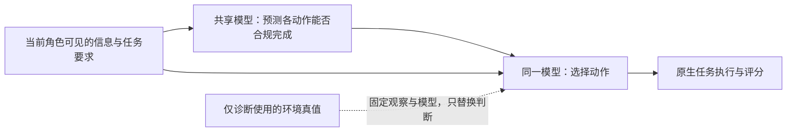

# 这轮解决哪个环节

目标仍是让同一个语言模型理解可信信息流和任务依赖，并据此选择合规且能完成任务的动作。这里有两个必须分别验证的能力：**判断关系是否允许任务继续**，以及**把判断用于行动**。

举例说，某个动作实际能够安全完成任务，但模型先判断“不能”。行动部分如果忠实遵循这个错误判断，就可能停止或只交付不完整结果。此时继续教它“遇到不能完成就停止”，可能减少违规，也会损失任务效用。

本轮下游干预已经验证：在上一轮交错模型实际到达的状态上，替换判断就能修复25个Source首次错误和30个Worker首次错误，没有把原本正确的动作变错。相同提示的原始输出控制通过。这表明这些具体状态的判断输入是可干预的错误来源。它没有证明替换后完整回合都成功，也没有让模型自己学会正确判断。

所以当前修复重点是改善关系判断，而不是继续强化停止动作。两组续训使用相同数量的更新、相同任务条件和答案，一组继续只用一跳，另一组加入已有两跳和三跳训练状态；同时重放少量已验证的行动纠正监督，尝试保留行动绑定。最终比较全新状态上的自行判断与完整执行，不能用训练损失或输入真值后的高分代替。

数据选择采取两层：自建、可执行且有配对干预的数据用于排查模型到底依赖关系还是表面符号；外部原生任务和真实规范用于检验实际效用与迁移。当前这轮只开展第一层学习实验。增加了训练深度，就必须用更深或不同结构的测试检验泛化；原三跳测试不能再当作深度外推。

训练来源补查进一步发现，早期trace模型已经从一到三跳数据采样；近期关系判断续训则只用一跳。因此本轮是补回近期监督覆盖，不能称为模型第一次学三跳。完整更正保留在 `SCOPE_CORRECTION.md`，冻结实验不作事后修改。

验收必须同时满足关系判断改善、结构留出有效、任务完成不低于较早强参考，以及安全不退步。即使局部门槛通过，也还需要新的独立验证，不能直接宣布自然业务规范迁移或32步协作完成。最终实测结果以 `REPORT.md` 为准。
